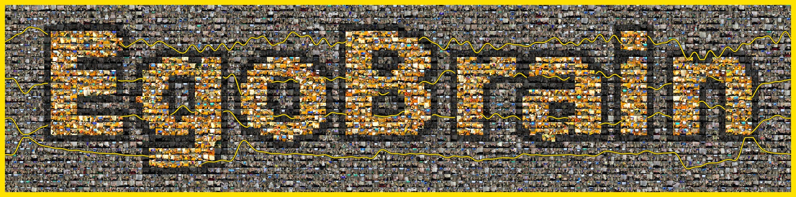
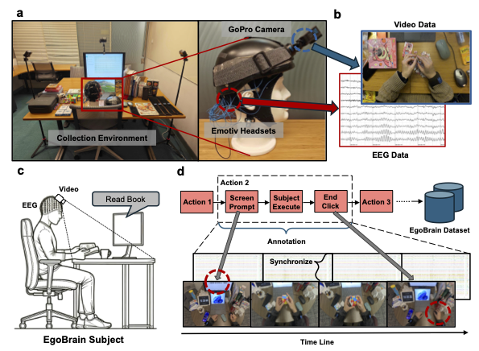
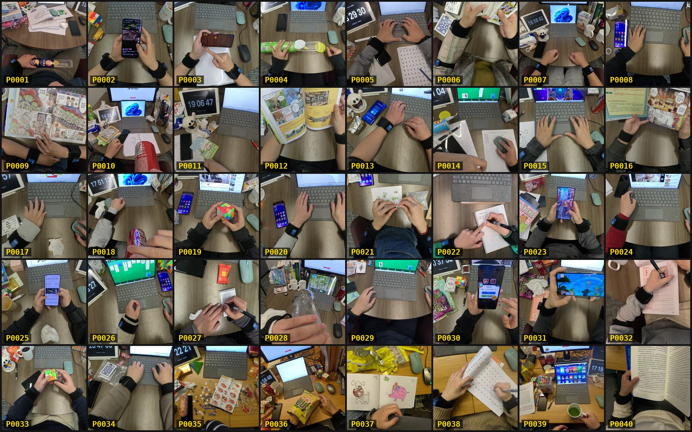

[](https://doi.org/10.82901/nemar.nm000629)

<p align="center">
  
</p>

<div align="center">

# EgoBrain-Mini (BIDS)
### Synchronised egocentric video, 32-channel EEG, body-worn IMUs and audio during everyday actions

**40** participants · **1,562** sub-actions · **63.0** hours of EEG · **4** synchronised modalities

[Project page](https://lin-nie.github.io/EgoBrain/) · [Paper (arXiv:2506.01353)](https://arxiv.org/abs/2506.01353) · [Original release on Hugging Face](https://huggingface.co/datasets/ut-vision/EgoBrain-Mini) · License CC BY-NC 4.0

</div>

---

This is the **BIDS edition of EgoBrain-Mini**, the lightweight companion release of the ICLR 2026 paper
*"EgoBrain: Synergizing Minds and Eyes For Human Action Understanding"* by Nie Lin, Yansen Wang, Dongqi Han, Weibang Jiang,
Jingyuan Li, Ryosuke Furuta, Yoichi Sato and Dongsheng Li (The University of Tokyo and Microsoft Research Asia). It is the
egocentric subset of EgoBrain: first-person video, EEG, IMU and audio, recorded from **the same person doing the same thing at the
same instant**. It was converted to BIDS for NEMAR and EEGDash by Bruno Aristimunha, with the first author's agreement and review.

**Source fidelity.** The EEG values are identical to the authors' raw arrays (checked for all 1,562 recordings; no filtering,
resampling or re-referencing was applied). Audio, video and the authors' processed EEG arrays are byte-identical copies; IMU
values are unchanged. Only names, file layout and metadata were added or corrected (see [Corrections](#corrections-to-the-original-release)).

<p align="center">
  
</p>

**(a)** The desk and the rig: a GoPro mounted on an EMOTIV EEG headset, so the camera moves with the head and the electrodes stay put.
**(b)** The two streams it produces: first-person video and 32 EEG traces from the same instant. **(c)** The seated participant with a
monitor in front of them. **(d)** How one sub-action gets its boundaries: a **screen prompt** names the task, the participant
**executes** it, then clicks **end**. That bracket, not a human scrubbing a timeline afterwards, is what a recording in this dataset is.

## What is in the box

| Modality | Location | Format | Rate / size |
|---|---|---|---|
| EEG (raw) | `sub-*/eeg/*_eeg.vhdr` (+ `.eeg`, `.vmrk`) | BrainVision, float32, microvolts | 32 channels at **256 Hz**, channel-selected, otherwise unprocessed |
| EEG (processed) | `derivatives/egobrain-clean/sub-*/eeg/*_desc-clean_eeg.npy` | float32 array `[32, T]`, standardized | **200 Hz**, the authors' processing, see [Processing](#processing) |
| IMU | `sub-*/motion/*_tracksys-imu{1..4}_motion.tsv` | headerless TSV with a `_channels.tsv` | 4 body-worn sensors, **rate varies by participant**, see [IMU](#imu) |
| Audio | `sub-*/beh/*_audio.wav` | WAV, mono PCM16 | **16 kHz**, the egocentric camera's own microphone |
| Egocentric video | `sub-*/beh/*_audiovideo.mp4` | H.264 / MP4 | **854 x 480 at about 30 fps** (its own microphone audio is embedded) |
| Events | `sub-*/eeg/*_events.tsv`, `sub-*/motion/*_events.tsv` | TSV | action extent, EEG quality flags, redaction windows |
| Recorded-experience catalog | `stimuli/` | BIDS-style catalog | links each recording to its audio/video, see [below](#recorded-experience-catalog) |
| Original release | `sourcedata/egobrain-mini-original/` | as released | all 17,520 files of the source release, see [Source data](#source-data) |
| Reader and example | `code/` | Python | lazy EEG/audio/video windows, see [Quick start](#quick-start) |

IMU sensors: `imu1` left wrist, `imu2` left upper arm, `imu3` right wrist, `imu4` right upper arm.

<p align="center">
  
  <br><sub>One sub-action from each of the 40 participants (P0001 to P0040), every frame from that participant's own first-person camera.</sub>
</p>

### Recording hardware and EEG reference

EEG was recorded with the **EMOTIV FLEX 2 Gel** (32 channels, 256 Hz). The **CMS/DRL reference sensors were placed on the
earlobes with the EMOTIV ear clips**; this is recorded in `EEGReference` of every `*_eeg.json`. The processed derivative is average
referenced (see [Processing](#processing)). Electrode coordinates were not released and none are invented here. Channel labels were
recovered from the original EMOTIV recordings in the authors' full EgoBrain release, and their order was verified against the released
raw waveforms for every participant. Age, sex and handedness were not part of the release (`n/a` in `participants.tsv`).

## Tasks

39 everyday actions, each recorded seated at a desk (prompt, execute, end click). The BIDS task label is the action name
and the letters A/B/C distinguish variants of the same activity:

`closingCalibration`, `drawComputerPictures`, `drawPictures`, `drawTracing`, `drinkBitterGourdJuice`, `drinkCocaColaA`, `drinkCocaColaB`, `drinkCocaColaC`, `drinkWaterA`, `drinkWaterB`, `drinkWaterC`, `eatSnackA`, `eatSnackB`, `eatSnackC`, `eatSpicyStrips`, `eatSugarsA`, `eatSugarsB`, `eatSugarsC`, `operateComputerExcel`, `operateComputerPowerpoint`, `operateComputerWord`, `playCards`, `playComputerGameKeyboard`, `playComputerGameMouse`, `playCube`, `playPhoneGameComplexA`, `playPhoneGameComplexB`, `playPhoneGameSimpleA`, `playPhoneGameSimpleB`, `playPuzzle`, `playToy`, `readComicBook`, `readResearchArticle`, `readTextbook`, `setupCalibration`, `watchMonitor`, `watchSmartphone`, `writeNotes`, `writeTracing`

`setupCalibration` and `closingCalibration` are short calibration actions at the start and end of a session. Participant P0037
repeated two actions, which appear as `run-1` and `run-2`. Each recording keeps the authors' segment id (for example
`P0001_phase2_037_eat-sugers-a`, in `scans.tsv` and the sidecars) so that every file can be traced back to the original release.

## Dataset structure

```
.
├── dataset_description.json, participants.tsv, README.md, CHANGES
├── task-<task>_events.json              events column descriptions (BIDS inheritance)
├── sub-P0001/
│   ├── sub-P0001_scans.tsv              files, artificial acquisition time, authors' segment id
│   ├── eeg/    sub-P0001_task-<task>_eeg.{vhdr,vmrk,eeg,json}, _channels.tsv, _events.tsv
│   ├── motion/ sub-P0001_task-<task>_tracksys-imu{1..4}_motion.{tsv,json}, _channels.tsv, _events.tsv
│   └── beh/    sub-P0001_task-<task>_audio.{wav,json}, _audiovideo.{mp4,json}
├── sub-P0002/ ... sub-P0040/
├── derivatives/egobrain-clean/          the authors' processed EEG arrays (200 Hz)
├── stimuli/                             recorded-experience catalog (audio/video + annotation tables)
├── sourcedata/egobrain-mini-original/   the complete original release
├── code/                                reader, example, README figures, task-name corrections
└── benchmark_index.{tsv,json}           per-recording manifest (files, media ids, duration) used by the reader; not a BIDS table
```

## IMU

Each sensor stream is stored as recorded, with its own rate. **The IMU rate is not the same across participants**: P0001 and P0022
onward logged at about 200 Hz (the intended setting), whereas P0002 to P0021 logged at about 10 Hz for the whole session (a
logging configuration difference, same hardware). Do not hard-code a rate: use `SamplingFrequency` in each `*_motion.json`, which was
computed from that file's own timestamps. The authors' main EgoBrain release does not include IMU data for P0002 to P0021;
EgoBrain-Mini releases it anyway, since a lower-rate signal is still real data.

**At about 200 Hz, timestamps come in batches.** The sensors send samples to the logger in small Bluetooth batches, and the logger
stamps every sample of a batch with the batch's arrival time, so most rows (80 to 90 percent) share the previous row's time. The
samples are real (values change from row to row); only the per-sample time is coarse. The `LATENCY` channel holds the logger
batch-arrival time in seconds relative to the segment start (EEG-anchored). For one time per sample, spread each batch evenly up to
the next batch, per device:

```python
import numpy as np

def respace(latency, imu_hz):
    """latency: one device's LATENCY column, sorted. Spread each batch evenly up to the next batch."""
    t = np.asarray(latency, float); out = t.copy()
    starts = np.flatnonzero(np.r_[True, np.diff(t) > 0])
    ends = np.r_[starts[1:], len(t)]
    for a, b in zip(starts, ends):
        nxt = t[b] if b < len(t) else t[a] + (b - a) / imu_hz
        out[a:b] = t[a] + (nxt - t[a]) * np.arange(b - a) / (b - a)
    return out
```

Acceleration is in standard gravity (g), angular velocity in degrees per second, magnetic field in microtesla. Padding at the
segment edges is documented per sensor in `EgoBrainSegment.imu_padding` of the `*_eeg.json` sidecars.

## How the modalities are aligned

The authors synchronised the modalities with an **EEG-anchored, cross-modal calibration**: EEG is the clock, and every other
modality's timeline is corrected to match it rather than aligned pairwise. In this edition the EEG, audio and video of a recording
share the clip origin released by the authors (`onset` 0 in `events.tsv`), and media start offsets are stored in the sidecars. The
actual media durations differ from the EEG duration by a median of about 0.02 s (maximum 0.07 s over all 1,562 recordings), and
readers should use the common measured coverage. This conversion did **not** perform an independent physical synchronisation
calibration; it relies on the authors' alignment and checks only coverage and timestamp consistency.

## Verification

By the authors, for every one of the 1,562 sub-actions (not a sample): all 32 EEG channels are finite with no flat or dead channel;
the alignment was fitted per participant and verified at independent anchors; EEG quality was screened with the headset's own
contact-quality readings and the raw amplitude. By this conversion:

- all 1,562 raw EEG payloads were compared sample by sample with the authors' arrays (identical);
- all audio, video and processed-EEG copies are byte-identical to the release, and IMU values are unchanged;
- the EEG channel order was verified against waveforms for all 40 participants;
- the dataset passes the BIDS validator and the NEMAR validation without errors.

## Known data issues

The files are left unaltered. Known problems are marked per recording in the `*_events.tsv` files as rows with
`trial_type` `bad_signal_quality_poor` or `bad_reference_contact_lost` (onset and duration in seconds from the recording start),
and the authors' segment id for each recording is in `scans.tsv`.

| Participant | Modality | Issue | Affected recordings | Recommendation |
|---|---|---|---|---|
| **P0008** | EEG | An electrode came loose twice; the signal is dominated by a 1 to 3 mV artifact shared across channels (normal EEG is about 0.05 to 0.15 mV) | 15 of 39 | Exclude from EEG analyses |
| **P0020** | EEG | An ear reference electrode (CMS/DRL) lost contact; all 32 channels are affected (alpha power about 85 percent lower; blinks and chewing still visible) | 32 of 39 | Exclude from band-power and amplitude-based analyses |
| P0025 | IMU | `imu3` (right wrist) logged at about 58 Hz while the other three held about 198.6 Hz (Bluetooth packet loss) | all | Treat `imu3` as sparse; do not assume a shared sample grid |
| P0029 | IMU | `imu2` (left upper arm) logged at about 62.8 Hz, others about 198.6 Hz | all | Treat `imu2` as sparse |
| P0031 | IMU | `imu1` (left wrist) logged at about 61 Hz, others about 198.6 Hz | all | Treat `imu1` as sparse |
| P0035 | IMU | `imu4` (right upper arm) logged at about 159 Hz, others about 198.6 Hz | all | Treat `imu4` as sparse |
| P0037 | IMU | `imu1` (left wrist) logged at about 49 Hz, others about 198.6 Hz (the slowest case) | all (41 recordings) | Treat `imu1` as sparse |
| P0039 | IMU | `imu2` (left upper arm) logged at about 152 Hz, others about 196 to 199 Hz (the mildest case) | all | Treat `imu2` as sparse |

For the EEG rows, video, audio and IMU are unaffected; for the IMU rows, video, audio and EEG are unaffected. **Important for EEG
users:** the `status` column of `*_channels.tsv` describes individual channels and reads `good` for every channel in every
recording. It does not encode these time-limited, all-channel problems for P0008 and P0020, so please use the events rows (or
exclude those participants) rather than relying on `channels.tsv`.

The IMU samples that a slow unit did record are real and correctly timestamped; there are simply fewer of them. The sampled
rate of every sensor is in its own sidecar.

## Ethics

The authors state in their paper (Lin et al., ICLR 2026, arXiv:2506.01353, Appendix B.1): "All subjects were informed of the experimental process and signed informed consent forms before the experiment. This study was approved by the ethical committee of local Institutional Review Board for Human Research Protections." The paper describes the 40 participants as 27 male and 13 female; individual age, sex and handedness are not part of the release (`n/a` in `participants.tsv`).

The paper does not name the review board or give a protocol number, so `EthicsApprovals` is not set in `dataset_description.json` rather than guessed. Questions about the approval can be sent to the maintainers at nielin@iis.u-tokyo.ac.jp.

## Privacy and responsible use

The release contains first-person video and participants' voices. Rather than blanking whole pictures, the authors applied
**region-limited blur** to the specific area of a frame that showed something sensitive (most often a laptop lock screen or app
window, a hand-held phone, earlier pages of a shared notebook, occasionally a bystander), only for the seconds it was visible, and
muted audio where the audio itself needed it. This affects **131 of the 1,562 sub-actions**, is baked into the media, and is marked in
the events files as `video_redacted` and `video_redacted_audio_muted` rows. Nothing else in the release is redacted, and we make no
claim that the media are fully anonymised.

**Please do not attempt to identify any participants, and use the data for non-commercial purposes only.** If you find content that
may reveal a participant's private information, please contact the maintainers at **nielin@iis.u-tokyo.ac.jp** so it can be
re-processed.

Acquisition times in this BIDS edition are replaced by an artificial epoch, and the clocks inside the source metadata copy are
shifted (see [Source data](#source-data)).

## What is not included

- Raw, unprocessed video (not distributed; `video` provenance in the source copy keeps the source file and frame range).
- Only Phase 2 (real-world action) sub-actions are included. The in-lab calibration and resting blocks stay in the full
  [EgoBrain](https://huggingface.co/datasets/ut-vision/EgoBrain) release.

## Quick start

```python
import mne
import pandas as pd

base = "sub-P0001/eeg/sub-P0001_task-eatSugarsA"
raw = mne.io.read_raw_brainvision(base + "_eeg.vhdr", preload=False)       # 32 channels, 256 Hz, microvolts
events = pd.read_csv(base + "_events.tsv", sep="\t")                        # action extent, quality flags, redactions

imu_base = "sub-P0001/motion/sub-P0001_task-eatSugarsA_tracksys-imu1"
channels = pd.read_csv(imu_base + "_channels.tsv", sep="\t")
imu = pd.read_csv(imu_base + "_motion.tsv", sep="\t", header=None, names=channels["name"])
print(raw.info["sfreq"], len(raw.times) / raw.info["sfreq"], "s;", imu.shape, "IMU samples")
```

For windowed multimodal access, `code/stimulus_reader.py` reads EEG, audio and video lazily from the catalog (a NeuralSet event
adapter plus a PyTorch-compatible batch example is in `code/example_read_stimuli.py`; dependencies in
`code/reader-requirements.txt`). On a sample of 24 windows from 8 participants the median one-second multimodal read took about
0.28 s. `benchmark_index.tsv` is a manifest of every recording with its files and media ids for benchmark-style loading.

### Recorded-experience catalog

`stimuli/` follows the layout of the open BIDS proposals for stimulus catalogs and media (BEP044 and BEP047, pinned at the revisions
named in the sidecars). These proposals are **not yet accepted BIDS extensions**, so the catalog is an experimental profile and the
standard BIDS validator ignores it. The camera and microphone recordings are **recorded experience, not experimentally presented
stimuli**: the participants were not shown these videos, they are what the participants saw and heard.

## Processing

The authors' processed EEG (`derivatives/egobrain-clean`) is produced by, in order: linear and 6th-order detrending, 0.1 to 75 Hz
bandpass, 50 Hz notch, resampling to 200 Hz, RANSAC-based bad-channel detection and interpolation, average reference, and
exponential-moving-average standardization. The raw EEG skips all of this: it is the channel-selected signal at its native
256 Hz in microvolts. The channel order of the processed arrays is taken to follow the raw arrays, as the authors' processing description implies; it was not independently re-verified.

## Source data

`sourcedata/egobrain-mini-original/` holds all 17,520 files of the authors' release at its pinned revision (the source repository
record is in `sourcedata/sourcedata_provenance.json`): per-participant manifests, segment metadata, raw and processed EEG arrays, IMU
tables, audio, video, and the authors' offline HTML reports. It is a **documented, metadata-de-identified copy**:

- participant recording clocks in manifests, segment metadata, reports and IMU timestamps are shifted by one whole-day offset per
  participant (intervals, durations and row order are preserved; the offset is not published);
- two recording-day comments in the shared viewer script were omitted in each copy (the executable code is unchanged);
- the source LFS declarations are commented out for git-annex packaging;
- EEG, audio and video payloads and all non-time IMU values are unchanged.

`sourcedata/egobrain-mini-source-copy-transformations.json` lists every path with its original and deposited checksum.
The unmodified release remains available from the authors on Hugging Face.

## Corrections to the original release

At the authors' request two task names that carried typos in the original release were corrected in this edition: `eatSugersA/B/C`
became `eatSugarsA/B/C` and `readResearchArcticle` became `readResearchArticle`. The correction applies to all BIDS, derivative
and catalog files; the authors' segment ids and the `sourcedata/` copy keep the original spelling, and
`code/task-name-corrections.tsv` gives the mapping. `EEGReference` was filled in from the authors' hardware description.

## Citation

If EgoBrain-Mini is useful in your research, please cite the paper:

```bibtex
@inproceedings{lin2026egobrain,
  title     = {EgoBrain: Synergizing Minds and Eyes For Human Action Understanding},
  author    = {Nie Lin and Yansen Wang and Dongqi Han and Weibang Jiang and
               Jingyuan Li and Ryosuke Furuta and Yoichi Sato and Dongsheng Li},
  booktitle = {International Conference on Learning Representations (ICLR)},
  year      = {2026},
  url       = {https://arxiv.org/abs/2506.01353}
}
```

Please also name the release you used so results stay reproducible: *EgoBrain-Mini (Hugging Face: `ut-vision/EgoBrain-Mini`),
40 subjects, 1,562 sub-actions, BIDS edition on NEMAR.*

## Acknowledgement

We sincerely thank all participants who contributed their time and effort to the data collection. This project was initiated and
developed during Nie Lin's research internship at Microsoft Research Asia (MSRA) and later continued at the Institute of Industrial
Science (IIS), The University of Tokyo. We thank all collaborators and mentors at MSRA and IIS for their guidance and support.

## License

EgoBrain-Mini is released under the **Creative Commons Attribution-NonCommercial 4.0 International (CC BY-NC 4.0)** license.
By using the dataset you agree to use it only for **non-commercial research purposes**, to **not attempt to identify any participant**,
and to comply with applicable ethical and data protection regulations. Questions about licensing or usage: **nielin@iis.u-tokyo.ac.jp**.

License details: https://creativecommons.org/licenses/by-nc/4.0/

[](https://creativecommons.org/licenses/by-nc/4.0/)
